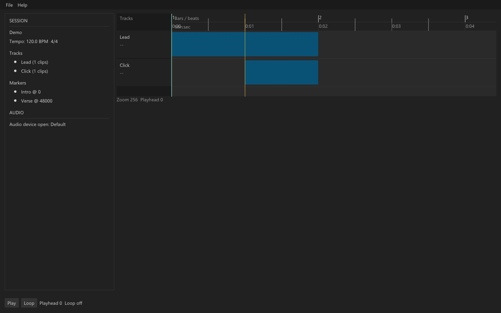
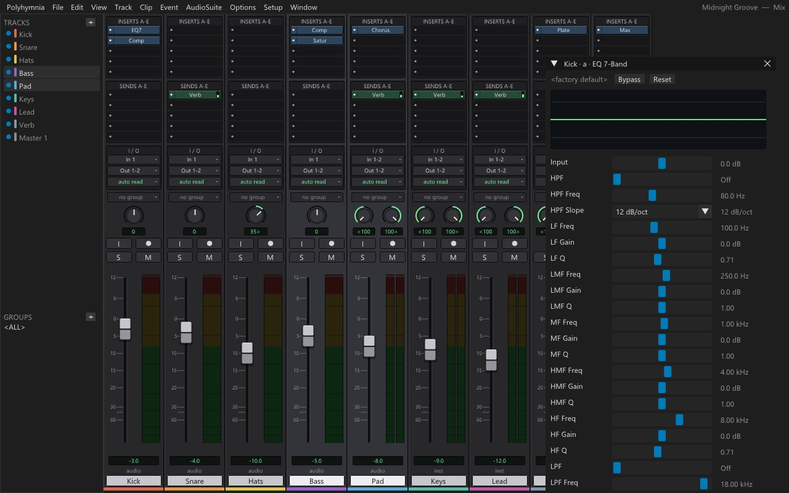

[](https://x.com/NorowaretaGemu)
[](https://opensource.org/licenses/MIT)

<br>
<div align="center">
  <a href="https://ko-fi.com/cursedentertainment">
    
  </a>
</div>
<br>
<div align="center">
  
  
  
  
</div>
<div align="center">
  
  
</div>
<br>

# Polyhymnia

**Music studio (DAW) for arranging and mixing.** Polyhymnia is Atelier's Pro Tools-style studio: an Edit window with
tracks, clips and waveforms, a Mix window with channel strips and built-in effects, recording and bounce. Part of
**[Atelier](https://github.com/CursedPrograms/Atelier)**. A C++ port of
**[SoundCraft](https://github.com/CursedPrograms/soundcraft)** (Rust, MIT OR Apache-2.0), ported with its tests.
**[Website](https://cursedprograms.github.io/Polyhymnia/)**





## What works so far

| Part | What you can do |
| --- | --- |
| **Import** | File > Import Audio (Ctrl+Shift+I): WAV, FLAC, MP3, AIFF, OGG, several at once; drag and drop from Explorer onto a track, empty space or the Clips list; files are copied into the project's Audio Files folder |
| **Edit window** | SoundCraft's layout and icons: the toolbar (Shuffle / Spot / Slip / Grid, the edit tools, counter, Grid and Nudge, transport, tempo and meter), Tracks and Groups lists, the Clips list, Bars\|Beats, Min:Secs, Tempo, Meter and Markers rulers, track headers (record, input, solo, mute, view, automation, volume, pan), coloured clips with waveforms and MIDI notes |
| **Editing** | Shuffle, Slip, Spot and Grid; cut, copy, paste, clear, duplicate, separate, heal, consolidate, nudge; fades in five shapes and crossfades; clip gain; undo and redo |
| **Mix window** | A channel strip per track: inserts, sends, I/O routing, automation mode, pan, input, record, solo, mute, fader and meters; busses and the master |
| **Built-in effects** | EQ 7-band, compressor, chorus, reverb (plate), limiter and more, each setting a slider |
| **Recording** | Arm tracks, input monitoring, takes written as WAV, punch and loop recording |
| **Bounce and export** | Mixdown to WAV, FLAC or MP3; stems and clips as files |
| **Keyboard** | Space plays and stops; the menu shortcuts work with the menus closed and take priority over the window, except while typing in a field |
| **Time** | Exact sample maths, tempo map, bars and beats, timecode, feet and frames, the grid |
| **Demo** | Opens with SoundCraft's *Midnight Groove* session to try everything |

**On the way:** ASIO, VST3 and CLAP plugins with the free Octavia plugins (SafetyPin, Fuzz14, stringtuner), the rest of
SoundCraft's shortcuts, automation, MIDI and the piano roll, video scoring.

## Minimum requirements

| | |
| --- | --- |
| **System** | Windows 10 or 11, 64-bit |
| **Processor** | Any 64-bit CPU |
| **Memory** | 4 GB RAM |
| **Graphics** | OpenGL 3.3 |
| **Disk** | 50 MB for the app |

## Build and run

```
cd cpp
build.bat
build\Release\Polyhymnia.exe
```

Test hooks (screenshot + log line):

```
Polyhymnia.exe --script skeleton --capture shot.bmp
Polyhymnia.exe --script session --capture shot.bmp
Polyhymnia.exe --script playback --capture shot.bmp
Polyhymnia.exe --script edit --capture build\Release\edit-shot.bmp
Polyhymnia.exe --script editing --capture build\Release\editing-shot.bmp
Polyhymnia.exe --audiotest build\Release\
Polyhymnia.exe --render build\Release\tone-test.polyhymnia build\Release\out.wav
```

Install shortcuts: `install.bat` beside the built tree (copies to `dist\Polyhymnia`).

## Credits

- **[SoundCraft](https://github.com/CursedPrograms/soundcraft)** — ported to C++: session model, editing, mixer, effects, recording, bounce, layout and icons (MIT OR Apache-2.0)
- **[Dear ImGui](https://github.com/ocornut/imgui)** — UI (MIT)
- **[SDL2](https://www.libsdl.org/)** — window and input (zlib)
- **[miniaudio](https://github.com/mackron/miniaudio)** — device and decode (public domain / MIT)

---

<div align="center">
  © Cursed Entertainment 2026
</div>
<div align="center">
  <a href="https://cursed-entertainment.itch.io/">
    
  </a>
</div>